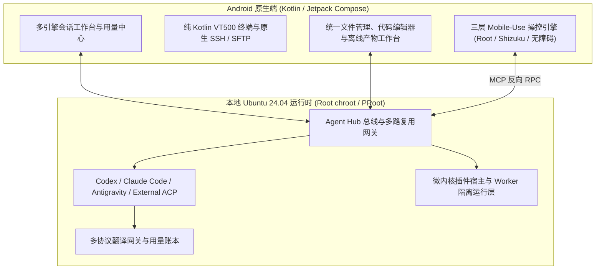

<div align="center">


# Solbraid

**面向 Android 的全栈多引擎 AI 编程工作台**

*Multi-Agent Coding Harness · Native VT500 & SSH Terminal · Embedded Linux Runtime · Mobile-Use · Plugin Microkernel*

[](app/build.gradle.kts)
[](app/src/main/java/com/galiais/agent)
[-E95420?style=flat-square&logo=ubuntu&logoColor=white)](runtime/components.json)
[](LICENSE)

[核心特性](#核心特性) · [架构概览](#架构概览) · [快速构建](#快速构建) · [开源协议](#开源协议)

</div>

---

**Solbraid** 将完整的本地多智能体开发、终端运维、文件编辑与移动设备自动化体验带到 Android。应用内置离线 Ubuntu 24.04 Linux 环境（支持 Root chroot 与免 Root PRoot 双模式），在同一套原生 Jetpack Compose 界面下统一驱动多款编码智能体与本地开发工具链。

## 核心特性

- **多引擎 AI 编程与并行编排**：原生统一接入 Codex、Claude Code、Antigravity 及外部 ACP / CLI 智能体；支持计划文档、实时步骤清单、结构化问答表单、编辑重发与重新生成，以及基于 Git Worktree 的多智能体隔离委派与 Diff 回收。
- **纯 Kotlin 原生终端与 SSH 工作台**：零 WebView、零外部终端内核，内置 CascadiaMonoNF 与 12 套深浅主题；支持 120fps 惯性流畅滚动、分屏与单 IME 协同、DEC Sixel / Kitty / 动态 GIF 内联图形、Braille 与 Sextant 矢量绘制、原生悬浮画中画视频播放、敏感凭据脱敏与会话录制；配套独立于 Linux 运行时的原生 SSH、SFTP、多密钥簿与端口转发隧道。
- **统一文件管理与离线产物工作台**：跨 Linux 工作区、容器/手机 Root 与 Android 存储（含 SAF 外部目录）统一管理文件；内置语法高亮代码编辑器、Diff 对比、全格式离线媒体与文档查看器，以及零外部 CDN 的 Artifact Studio（HTML、React/JSX、SVG、Mermaid、LaTeX、Markdown、CSV）。
- **三层 Mobile-Use 手机操控**：统一支持 Root、Shizuku 与免 Root 无障碍服务三种后端，以标准 MCP 工具向全部智能体开放界面感知与自动化操控，并内置人工审批弹窗、前台守卫与悬浮急停开关。
- **多协议网关、用量账本与微内核插件**：内置 OpenAI / Anthropic / Gemini 协议双向翻译网关与精确 Token / 解码速率 / 缓存计费账本；提供支持能力协商、Worker 线程隔离、原生 Compose SDUI 与热插拔 UI 插槽的插件微内核。

## 架构概览



## 快速构建

**环境要求**：JDK 17、Android SDK、Node.js 20+。

```bash
# 运行时与核心链路自测
node tools/self-test.mjs

# 运行单元测试并构建 Debug APK（macOS / Linux）
./gradlew testDebugUnitTest assembleDebug

# Windows PowerShell（单 ABI 快速构建）
.\gradlew.bat testDebugUnitTest assembleDebug -PsolbraidAbis=arm64-v8a --no-daemon
```

构建产物输出至 `app/build/outputs/apk/debug/`，并在打包结束时自动校验运行时资产完整性。

## 开源协议

基于 [GNU Affero General Public License v3.0 (AGPL-3.0)](LICENSE) 协议开源。
