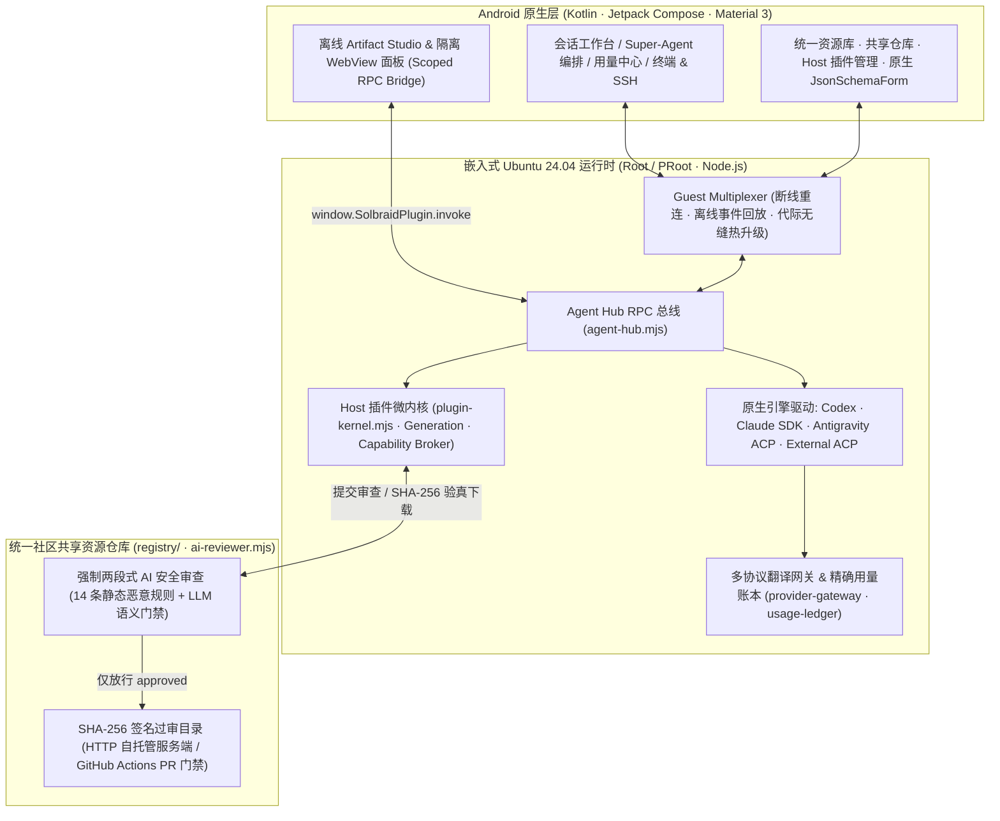

<div align="center">


# Solbraid

**面向 Android 的全栈多引擎 AI 编程工作台与可插拔 Agent 微内核**

*Mobile-First Multi-Agent Coding Harness · Embedded Linux Runtime · Microkernel Plugin System · AI-Audited Community Registry*

[](https://github.com/GALIAIS/Solbraid)
[-3DDC84?style=flat-square&logo=android&logoColor=white)](app/build.gradle.kts)
[](app/src/main/java/com/galiais/agent)
[-E95420?style=flat-square&logo=ubuntu&logoColor=white)](runtime/components.json)
[](.github/workflows/registry-ai-review.yml)
[](LICENSE)

[核心特性](#-核心特性) · [系统架构](#-系统架构) · [插件微内核](#-host-插件微内核) · [共享资源仓库与-ai-审查](#-统一共享资源仓库与强制-ai-安全审查) · [快速构建](#-快速开始与构建) · [编写第一个插件](#-编写你的第一个-solbraid-插件)

</div>

---

## 简介

**Solbraid** 将完整的多智能体工程开发体验装进 Android 设备。它在本地原生运行 **Ubuntu 24.04 Linux 环境**（支持 Root 与免 Root PRoot 双模式），在同一套高帧率 Jetpack Compose 界面下原生驱动 **Codex**、**Claude Code**、**Antigravity** 及任意 **ACP 协议外部 Agent**，并内置微内核插件总线、多协议 API 转换网关、精确用量账本、离线交互产物工作台、全功能 PTY 终端、SSH/SFTP 运维套件，以及带有**强制 AI 安全审查门禁**的统一社区共享资源仓库。

---

## ✨ 核心特性

### 1. 多引擎原生协同与 Super-Agent 编排
- **三大原生编程引擎统一接入**：深度对齐官方协议栈，支持 **Codex** (`0.171.0-alpha.13`)、**Claude Code** (`2.1.328` / Agent SDK `0.3.328`) 与 **Antigravity** (`1.5.15` 原生 ACP)，并可扩展任意第三方 ACP / CLI Bridge Agent。
- **完整交互原语**：原生支持计划文档（Plan Artifacts）、实时步骤清单（Live Steps）、结构化多步提问（Structured Questions）与 JSON Schema 动态表单（Elicitation）。
- **Git Worktree 并行编排与多边委派**：按角色为多智能体分配不同引擎、模型与隔离 Worktree 分支，内置 `delegate_to_agent` 跨引擎委派 MCP 与 Diff 审查合并回收流程。

### 2. 精确多协议网关与用量中心
- **本地多协议翻译网关**（`runtime/provider-gateway.mjs`）：透明桥接 OpenAI Responses / Chat Completions、Anthropic Messages 与 Google Gemini 协议，随时无缝切换会话服务商。
- **高精度用量账本**（`runtime/usage-ledger.mjs`）：区分流式纯解码吞吐（Decode TPS）与端到端速率、精确分离 Input / Cache Read / Cache Write / Output 计费、TTFT 首字延迟、会话级上下文窗口水位及热力图统计。

### 3. 移动全栈开发工作台
- **嵌入式终端 & SSH / SFTP**：基于 xterm.js 的多标签真 PTY 终端，内置 SSH 密钥簿、端口转发隧道、本地 TCP 多路预览与远程 SFTP 文件管理。
- **离线产物工作台（Artifact Studio）**：零外部 CDN 离线渲染 HTML、React/JSX + Hooks、SVG（严格白名单防 XSS）、Mermaid 流程图、交互式图表、LaTeX（内置离线渲染 + 原生引擎编译）、Markdown 与可排序 CSV。
- **克制编辑风 & Material You 主题系统**：支持 7 维外观自定义、悬浮磨砂胶囊输入栏、零掉帧 `/` 指令与 `@` 文件补全浮窗。

---

## 🏗 系统架构



---

## 🧩 Host 插件微内核

参考 **Cordis Generation 生命周期**与 **Capability Broker** 设计理念，[runtime/plugin-kernel.mjs](runtime/plugin-kernel.mjs) 为 Solbraid 提供统一的微内核扩展基座：

| 机制 | 设计说明 |
| :--- | :--- |
| **静态 Manifest 校验** | 加载前静态校验 `solbraid-plugin.json`，拦截非法 ID、SemVer、路径穿越与软链逃逸 |
| **Fail-Closed 能力协商** | 13 项标准能力（`commands`、`settings.schema`、`ui.panel`、`workspace.read`、`storage.local`、`events.observe`、`rpc`、`agent.driver` 等）；缺失或撤销 `required` 拒绝激活，撤销 `optional` 优雅降级 |
| **Generation & LIFO 释放** | 每次重载分配唯一 `generationId` 与 `AbortSignal`，卸载/重载时按逆序执行全部 `ctx.effect()` 清理 |
| **单插件故障隔离** | 单扩展异常自动捕获并标记 `failed`，绝不拖垮 7 大核心常驻服务或其他插件 |
| **安全模式 & LKG 回滚** | 支持一键切入 Safe Mode（仅保留核心服务）及回滚至 `plugins-last-known-good.json` 正常快照 |
| **声明式 UI & 双向安全桥** | 插件通过 `settingsSchema` 自动生成原生 Compose 配置抽屉；WebView 面板仅能通过 `window.SolbraidPlugin.invoke()` 调用自身 `plugin.<id>.*` 命名空间 RPC |

> **执行层边界透明说明**：Host 微内核插件运行于同进程受信任 Node.js 环境（`trusted-in-process`），能力授权用于兼容协商、最小权限约束与审计，不宣称操作系统级沙箱隔离。

---

## 🛡 统一共享资源仓库与强制 AI 安全审查

资源库彻底移除硬编码精选推荐，提供统一的 **「共享仓库」** 用于托管用户上传并分享的全类型资源（`instruction` 指令、`mcp`、`skill` 技能、`subagent` 子代理、`hook` 钩子、`host_plugin` 运行时插件、`plugin_pack` 插件包）。

为防止恶意代码或提示词投毒传播，**所有上传资源均必须通过仓库强制两段式 AI 安全审查（严格 Fail-Closed）**：

1. **确定性静态恶意规则扫描（[runtime/ai-reviewer.mjs](runtime/ai-reviewer.mjs)）**：实时检测反弹 Shell、`curl | sh` 管道执行、高危破坏性删除命令、SSH 私钥/环境变量密钥外传、Unicode Bidi 特洛伊字符混淆、`eval`/`new Function`/Base64 解码执行、未声明权限导入 `child_process`/`fs`/底层网络、路径穿越及提示词越权注入。命中 `critical` / `high` 直接阻断并隔离。
2. **仓库 AI 语义安全门禁**：支持接入 OpenAI 兼容或 Anthropic 审查模型，对代码意图、隐蔽外联与供应链风险进行结构化语义审计；严格模式下若 LLM 不可用或返回异常一律挂起拒发。
3. **客户端下载二次验真**：下载安装时强制核对 `audit.verdict === "approved"`、规范化载荷 `SHA-256` 指纹防篡改，并执行客户端二次静态复检。

支持三种仓库接入模式：
- **内置本地/自托管共享仓库**（零配置开箱体验上传审查与下载闭环）
- **独立远程 HTTP 仓库服务端**（运行 [registry/registry-server.mjs](registry/registry-server.mjs)，适合团队或社区公开部署）
- **GitHub 社区仓库 + PR 门禁**（借助 [.github/workflows/registry-ai-review.yml](.github/workflows/registry-ai-review.yml) 自动审查每个资源 PR，未过审禁止合并）

---

## 📁 目录结构

```text
Solbraid/
├── app/                                 # Android 客户端 (Kotlin + Jetpack Compose)
│   └── src/main/java/com/galiais/agent/
│       ├── engine/                      # 会话仓储、扩展仓库、运行时桥接、模型与加密配置
│       └── ui/                          # 聊天工作台、用量中心、终端、SSH、插件管理与共享仓库 UI
├── runtime/                             # 嵌入式 Linux Node.js 运行时与内核脚本
│   ├── agent-hub.mjs                    # 多引擎调度与统一 RPC 总线
│   ├── plugin-kernel.mjs                # Host 插件微内核（Generation / Capability / LKG）
│   ├── plugin-builtins.mjs              # 7 大核心服务插件与工作区体检示范插件
│   ├── ai-reviewer.mjs                  # 两段式 Fail-Closed 静态 + AI 安全审查器
│   ├── community-registry.mjs           # 共享资源仓库客户端与下载验真引擎
│   ├── provider-gateway.mjs             # 多协议 API 转换网关
│   ├── usage-ledger.mjs                 # 精确 Token / 吞吐 / 费用账本
│   ├── extension-sync.mjs               # 三大 CLI 配置无侵入单源投影器
│   └── artifact-*.{html,js}             # 零 CDN 离线产物与插件面板渲染引擎
├── registry/                            # 独立共享资源仓库服务端与 CI 审查脚本
│   ├── registry-server.mjs              # 零依赖 HTTP 社区仓库服务端
│   ├── ci-audit.mjs                     # GitHub Actions PR 强制 AI 审查入口
│   └── README.md                        # 仓库自托管与部署指南
├── tools/
│   └── self-test.mjs                    # 11 项运行时、插件内核与 AI 审查全链路自测套件
└── .github/workflows/
    └── registry-ai-review.yml           # 社区仓库 PR 强制 AI 安全门禁工作流
```

---

## 🚀 快速开始与构建

### 环境要求
- **JDK 17** & **Android SDK**（`compileSdk 36` / `targetSdk 35`）
- **Node.js 20+**（用于运行时资产校验与自测套件）
- Android 9.0+ 设备（`arm64-v8a` 或 `x86_64`）

### 运行时与 AI 安全审查自测

```bash
node tools/self-test.mjs
```

> 覆盖协议翻译器、精确用量账本、本地网关 E2E、Mermaid 渲染、三端扩展同步、ACP / CLI Bridge 驱动、Guest Mux 热升级、PTY/委派 MCP、Host 插件微内核以及社区仓库恶意代码拦截与防篡改全链路。

### 构建 Android Debug APK 与单元测试

```bash
# macOS / Linux
./gradlew testDebugUnitTest assembleDebug

# Windows PowerShell
.\gradlew.bat testDebugUnitTest assembleDebug --no-daemon
```

构建完成后将在 `app/build/outputs/apk/debug/` 输出分包 APK（`app-arm64-v8a-debug.apk`、`app-x86_64-debug.apk`），并自动运行 `verifyDebugRuntimePackage` 完整性校验。

### 启动独立共享资源仓库服务端（可选）

```bash
SOLBRAID_REVIEWER_API_URL=https://api.openai.com/v1 \
SOLBRAID_REVIEWER_API_KEY=your-api-key \
SOLBRAID_REVIEWER_MODEL=gpt-4o-mini \
SOLBRAID_REQUIRE_LLM=1 \
node registry/registry-server.mjs --port 8787 --dir ./registry/data
```

更多自托管与 GitHub PR 门禁配置请参阅 [registry/README.md](registry/README.md)。

---

## 🛠 编写你的第一个 Solbraid 插件

在 App「资源库 → 插件 → `+ 本地插件`」可一键生成脚手架，或在 `~/.galiais/plugins/<plugin-id>/` 下创建两个文件即可热加载，并通过「共享仓库 → `+ 上传分享`」分享给其他用户：

**`solbraid-plugin.json`**
```json
{
  "manifestVersion": "1.0.0",
  "apiVersion": ">=1.0.0 <2.0.0",
  "id": "community.hello-panel",
  "name": "示例工作台插件",
  "version": "1.0.0",
  "description": "演示斜杠命令、原生 Schema 配置与 WebView 双向 RPC 面板",
  "kind": "local",
  "entrypoint": "index.mjs",
  "capabilities": {
    "required": ["commands", "settings.schema", "ui.panel", "rpc"],
    "optional": ["events.observe", "storage.local"]
  },
  "settingsSchema": {
    "type": "object",
    "properties": {
      "greeting": { "type": "string", "title": "问候语", "default": "Hello Solbraid!" }
    },
    "required": ["greeting"]
  }
}
```

**`index.mjs`**
```js
export async function activate(ctx) {
  ctx.rpc.register("ping", async () => ({
    greeting: ctx.settings.get().greeting,
    generation: ctx.host.generationId,
    ts: Date.now(),
  }));

  ctx.commands.register("hello", {
    description: "返回插件配置问候语",
    handler: () => ({ kind: "notice", message: ctx.settings.get().greeting }),
  });

  ctx.panels.register({
    id: "main",
    title: "示例面板",
    render: () => `<!doctype html><html><body style="font-family:system-ui;padding:16px">
      <h2>Solbraid Plugin Panel</h2>
      <button onclick="window.SolbraidPlugin.invoke('ping').then(r => alert(r.greeting))">调用插件 RPC</button>
    </body></html>`,
  });
}
```

---

## 📄 开源协议

本项目基于 **[GNU Affero General Public License v3.0 (AGPL-3.0)](LICENSE)** 协议开源。
