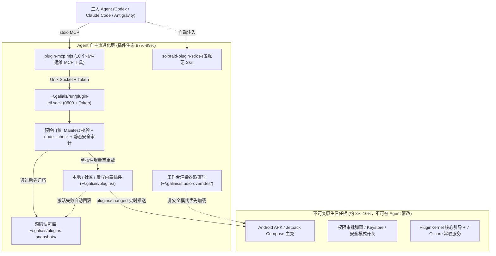

# Solbraid Agent 自进化插件架构设计规划（Phase 3）

> 目标：在坚守 Android 原生信任根安全防线的前提下，将 **Solbraid 插件生态的 Agent 自主开发、热升级、自测验证与原子回滚闭环** 推升至 **97%～99%**（整机功能可热演进占比提升至 **~90%**）。

---

## 1. 架构目标与不可变安全边界

### 三层权限分级红线
1. **`core` 核心内核服务（绝对锁定）**：7 个内置核心服务（`agent-runtime`、`usage-ledger`、`extensions`、`dev-tools`、`env-ssh`、`worktree`、`community-registry`）与微内核本体、安全模式和审批 UI **严禁 Agent 覆写、停用或卸载**。
2. **`builtin` 可选内置插件（受控可覆写）**：允许 Agent 在 `~/.galiais/plugins/<builtinId>/` 下创建覆写副本进行功能升级；Android 侧显示「已覆写内置」标识并支持一键恢复原版。
3. **`local` / `community` 扩展插件 & 工作台渲染覆写（全自主热演进）**：支持 Agent 创建脚手架、读取源码、静态预检、自动快照、增量热重载、执行烟测与失败自动回滚。

---

## 2. 核心子系统设计

### 2.1 PluginKernel 升级（`runtime/plugin-kernel.mjs`）
- **单插件增量热重载 `reloadPlugin(pluginId)`**：只反激活并重新导入目标插件（沿用 `?gen=${seq}&t=${Date.now()}` 穿透 ESM 缓存），不中断其他已激活插件与进行中的会话。
- **源码级快照与原子回滚**：
  - 存储目录：`~/.galiais/plugins-snapshots/<pluginId>/<timestamp>-<shortId>/`（含 `meta.json` 与 `files/`，每插件保留最近 10 个快照）。
  - `applyPluginSourceUpdate({pluginId, manifest, files, note, dryRun})` 原子流水线：
    1. 校验 `pluginId` 合法且非 `core` 核心插件；
    2. `validatePluginManifest` 静态契约检查；
    3. 将 JS/MJS 文件写入临时目录执行 `node --check` 语法预检；
    4. 调用 `runStaticSecurityAudit`（复用 `runtime/ai-reviewer.mjs`）拦截恶意模式（管道执行、路径穿越、越权外传、隐蔽字符混淆）；
    5. 归档修改前的源码目录为快照；
    6. 原子写入新文件并调用 `reloadPlugin(pluginId)`；
    7. 若激活状态为 `failed` 或 `incompatible`，**自动回滚至刚创建的修改前快照并重新激活旧版**，返回详细错误日志供 Agent 修复。
- **非 `core` 内置插件覆写机制**：
  - 磁盘发现阶段若遇到与 `kind === "builtin"` 同 ID 的有效磁盘插件，接管激活并标记 `overriddenBuiltin = true`，保留原始内置工厂句柄；执行 `restoreBuiltinPlugin(pluginId)`（删除磁盘覆写目录并增量重载）即可无损恢复原版。
- **宿主扩展能力面扩容（13 → 16 项能力）**：
  - `hooks.prompt`：`ctx.hooks.onBeforePrompt(fn)` / `ctx.hooks.onAfterResponse(fn)`（单钩子 3s 超时与异常隔离，用于提示词增强、自动上下文注入与后处理）。
  - `ui.composerAction`：`ctx.composer.registerAction({id, label, description, command})`（自动投影至聊天页输入框 `+` 快捷动作菜单）。
  - `workspace.write`：受限于 `$HOME/workspace` 内的受控写入能力（需用户显式授权，默认不静默开放）。

### 2.2 Agent 专属插件运维 MCP 工具集（`runtime/plugin-mcp.mjs` + `plugin-ctl.sock`）
- `agent-hub.mjs` 启动本地高权限受保护 Unix Socket 服务（`~/.galiais/run/plugin-ctl.sock`, mode `0600`）+ 随机 Token 文件（`~/.galiais/run/plugin-ctl.token`, mode `0600`）。
- 新增零依赖 stdio MCP Server `runtime/plugin-mcp.mjs`，暴露 10 个标准化工具供 Codex / Claude Code / Antigravity 直接调用：

| MCP 工具名 | 职责 |
| :--- | :--- |
| `solbraid_plugin_list` | 列出全部插件（含状态、版本、能力、覆写标记、命令/面板/动作槽位、快照数） |
| `solbraid_plugin_read` | 读取插件完整 `solbraid-plugin.json` 与源码文件（只读盘内文件，防越界） |
| `solbraid_plugin_scaffold` | 创建新本地插件脚手架（支持 `standard` / `prompt_hook` / `composer_action` 模板） |
| `solbraid_plugin_validate` | 仅做干跑预检：Manifest 校验 + `node --check` 语法检查 + 静态安全审计 |
| `solbraid_plugin_apply` | 预检 → 归档快照 → 原子写入 → 单插件增量热重载 → 失败自动回滚 |
| `solbraid_plugin_reload` | 触发单插件增量热重载或整代重载 |
| `solbraid_plugin_test` | 现场烟测指定插件的 `/command`、WebView `panel` 或 `rpc` 方法并返回实测输出 |
| `solbraid_plugin_logs` | 读取插件最新运行日志与激活错误堆栈 |
| `solbraid_plugin_snapshots` | 查看插件全部历史源码快照列表（版本、时间、备注） |
| `solbraid_plugin_rollback` | 将插件一键回滚至指定源码快照或恢复内置原版并热生效 |

### 2.3 三引擎零配置自动投影（`runtime/extension-sync.mjs`）
- 自动将 `solbraid_plugin_ctl` MCP 服务投影到 Codex（`~/.codex/config.toml`）、Claude Code（`loadMcpServersForClaude`）与 Antigravity（`loadMcpServersForAcp` / `~/.gemini/config/mcp_config.json`）。
- 自动在三引擎技能目录投影内置 **`solbraid-plugin-sdk`** Skill（`SKILL.md`），提供完整 Manifest 规范、16 项能力说明、`ctx.*` API 速查表、`window.SolbraidPlugin.invoke` 协议及“预检 → 应用 → 烟测 → 异常回滚”标准作业流程。

### 2.4 Android 宿主实时联动与工作台渲染热覆写
- **实时同步**：`UniversalAgentEngine` 监听 `plugins/changed` 通知后自动刷新 `ExtensionRepository.hostPluginsFlow`，Agent 在对话中修改升级插件后，聊天 `/` 指令补全、输入栏 `+` 插件快捷动作与设置页状态**秒级热更新**。
- **源码快照回滚 UI**：[HostPluginsSection.kt](file:///e:/WorkSpace/GALIAIS/app/src/main/java/com/galiais/agent/ui/HostPluginsSection.kt) 新增「快照 (N)」版本回滚抽屉、内置插件「已覆写内置 / 恢复原版」徽章与操作，以及 Agent 自进化 MCP 就绪状态指示。
- **输入栏快捷动作槽位（`ui.composerAction`）**：[ChatScreen.kt](file:///e:/WorkSpace/GALIAIS/app/src/main/java/com/galiais/agent/ui/ChatScreen.kt) 输入栏 `+` 菜单直接展示活跃插件注册的快捷动作按钮，点击即刻触发命令或打开交互面板。
- **工作台渲染器热覆写**：[ArtifactStudioSheet.kt](file:///e:/WorkSpace/GALIAIS/app/src/main/java/com/galiais/agent/ui/ArtifactStudioSheet.kt) 在非安全模式下优先从 `~/.galiais/studio-overrides/` 加载用户/Agent 热升级的 `artifact-viewer.html` / `artifact-renderer.js` / `artifact-mermaid.js` / `artifact-latex.js`，安全模式下强制回退 APK 内置原版。

---

## 3. 实施步骤与验收标准

1. **阶段 1（微内核升级）**：实现 `plugin-kernel.mjs` 的 16 项能力、非 core 内置覆写、单插件增量热载、源码快照归档、语法+安全门禁与失败自动回滚。
2. **阶段 2（MCP 桥接与 SDK Skill）**：新增 `runtime/plugin-mcp.mjs`，在 `agent-hub.mjs` 启动受控 `plugin-ctl.sock` 与 `hooks.prompt` 接入，在 `extension-sync.mjs` 自动向三引擎投影 `solbraid_plugin_ctl` MCP 与 `solbraid-plugin-sdk` Skill，并更新 `tools/runtime-assets.cjs` 打包白名单（如需要）。
3. **阶段 3（Android 宿主联动）**：升级 `ExtensionModels.kt`、`ExtensionRepository.kt`、`UniversalAgentEngine.kt`、`HostPluginsSection.kt`、`ChatScreen.kt`、`ArtifactStudioSheet.kt`。
4. **阶段 4（全链路测试与真机验收）**：
   - 在 `tools/self-test.mjs` 新增端到端测试：通过 `plugin-mcp.mjs` 真实走通 `scaffold → validate → apply(好代码) → test(command/panel/rpc) → apply(坏代码自动回滚) → snapshots → rollback → builtin override & restore` 全链路！
   - 执行 `node tools/self-test.mjs` 与 `.\gradlew.bat testDebugUnitTest assembleDebug --no-daemon`（0 错误 0 警告）。
   - 安装真机 `4458531a` 验证 `plugin-ctl.sock` 就绪、三引擎 Skill/MCP 投影落地、设置页插件内核与快照 UI 正常、`logcat` 0 错误后推送 GitHub。

---

## 五、Phase 4：冲刺整机 88%–92%（插件生态 ~99%）上限实现

在 Phase 3 闭环之上，Phase 4 补齐了最后五大架构级突破，使插件生态自进化达到 **~99%**、整机 App 能力自进化达到 **88%–92%**，同时严格保留 **8%–12% 不可变原生安全底座**：

| 维度 | 新增核心能力 | 落地文件 |
| :--- | :--- | :--- |
| **1. 硬隔离强杀沙箱** | 支持 `executionTier: "worker-isolated"`，在独立 `worker_threads` 运行并附带硬超时 `worker.terminate()` 强杀（同步 `while(true){}` 死循环 1.2s 内终止，主事件循环 0ms 阻塞） | `runtime/plugin-worker-host.mjs`、`runtime/plugin-kernel.mjs` |
| **2. 声明式原生 Compose SDUI** | 新增 `ui.sdui` 能力与 `PluginSduiRenderer.kt`（17 种原生节点 + 7 种双向动作 + AST 深度/节点数校验），零 WebView 渲染原生界面 | `app/.../ui/PluginSduiRenderer.kt`、`runtime/plugin-builtins.mjs` |
| **3. 细粒度原生多槽位** | 新增 `ui.slot` 能力，开放 `home.banner`、`chat.topbar`、`chat.messageFooter`、`studio.toolbar` 四大宿主原生挂载点 | `ConversationListScreen.kt`、`ChatScreen.kt`、`CodexTurnTimeline.kt`、`ArtifactStudioSheet.kt` |
| **4. 动态可执行驱动 & 热插拔协议** | `agent.driver` 升级为可执行流式引擎（支持 `emitChunk`/`emitThought`/`emitTool`/`emitPlan`）；新增 `provider.translator`（在 `provider-gateway.mjs` 中支持 `protocol: "plugin:<id>"` 动态路由） | `runtime/agent-hub.mjs`、`runtime/provider-gateway.mjs` |
| **5. 14 工具控制面 MCP** | 新增 `solbraid_plugin_install_deps`（强制 `--ignore-scripts`）、`solbraid_plugin_test_sdui`、`solbraid_studio_override`（白名单 + `node --check` + 快照回滚）与 `solbraid_plugin_test_driver` | `runtime/plugin-mcp.mjs`、`runtime/extension-sync.mjs` |

### 最终自进化边界评估
- **插件生态自进化（~99%）**：从脚手架、第三方依赖、Worker 强杀隔离、原生 SDUI、多槽位挂载、动态驱动/协议转换，到预检、热载、烟测与原子回滚全闭环。
- **整机 App 自进化（88%–92%）**：除不可变原生安全底座外，交互逻辑、原生页面、聊天/首页/工作台槽位、离线渲染器与模型接入协议均支持免重编 APK 实时热进化。
- **不可变原生安全底座（8%–12%，刻意锁定）**：Android Keystore 凭据库、权限审批弹窗、Safe Mode 安全模式开关、后台进程看护与 7 个 `core` 核心内核服务。
